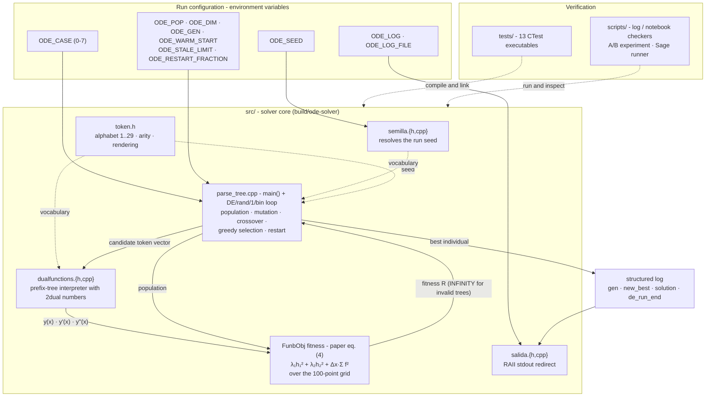
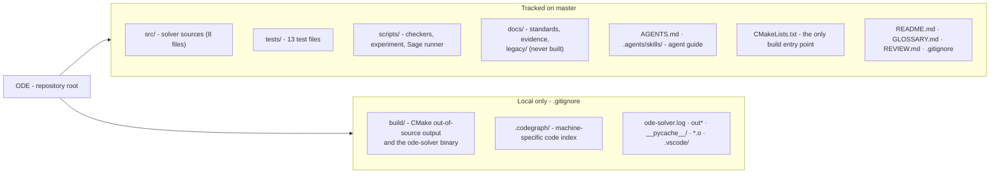

# ODE — Symbolic ODE Solver via Differential Evolution

A C++ research prototype that searches for **symbolic (closed-form) solutions** to second-order ordinary differential equations (ODEs) using a Differential Evolution / genetic-programming hybrid loop.

Based on the article: [Solving Ordinary Differential Equations Using Differential Evolution](https://www.hindawi.com/journals/ddns/2015/910316/) (Hindawi, 2015).

## Project map

Two views of the same repository: the logical architecture of the solver and
how the work is organised in Git.

### Logical architecture

`build/ode-solver` is one executable built from `src/` and steered by
environment variables; the search loop calls the evaluator for every candidate
and feeds the resulting fitness back into selection:



### Git repository

`master` tracks sources, tests, scripts and docs; the CMake output and local
tooling stay out of the index:



### Merging to master

`master` only receives changes through a pull request. Start from the current
remote tip, keep the branch short-lived and tie it to the issue
(`feat/`, `fix/`, `docs/`, `chore/`, `refactor/`):

```bash
git fetch origin
git switch -c feat/issue-N-short-name origin/master
```

Humans and agents follow the same path:

| Step | Human | Agent |
|------|-------|-------|
| Commit | Conventional Commits, one logical change | Same |
| Push | `git push -u origin HEAD` | Same; never commit or push directly to `master` |
| Open the PR | `gh pr create --base master --fill` | `gh pr create --base master --title "type(scope): ..." --body-file <file>` |
| Merge | GitHub **Merge pull request**, or `gh pr merge <n> --merge --delete-branch` | Same, once the evidence is in the PR body |

Use the `.agents/skills/pr` template for the PR body (Summary, Evidence, Merge
Danger) and link the issue with `Closes #<n>`. Under **Evidence**, include the
commands and results that prove the change works; for solver changes that means
at least `ctest --test-dir build` plus the affected `scripts/check_*.py`.

GitHub supports merge commits, squash, and rebase; this repository uses merge
commits (`gh pr merge --merge`) so the branch history stays visible. Delete the
branch after merging.

## How it works

The program evolves a population of candidate expressions (parse trees) to find a function `y(x)` that satisfies a given ODE together with initial/boundary conditions.

### Representation

Each individual in the population is a `vector<long double>` of integer token codes in **prefix notation**. The alphabet is defined once in `token.h` and spans the contiguous codes `1`–`29`:

| Tokens | Meaning |
|--------|---------|
| `1`–`10` | Constants 1.0–10.0 |
| `11` | Variable `x` |
| `12` | Negation |
| `13` | sin |
| `14` | cos |
| `15` | exp |
| `16` | log |
| `17` | sqrt |
| `18` | Addition (+) |
| `19` | Multiplication (*) |
| `20` | Division (/) |
| `21` | Power (^) |
| `22` | tan |
| `23` | sinh |
| `24` | cosh |
| `25` | tanh |
| `26` | `x²` leaf (evaluated as `x·x`) |
| `27` | `x³` leaf (evaluated as `x·x·x`) |
| `28` | Constant π |
| `29` | Constant e |

### Evaluation with 2nd-order dual numbers

Expressions are evaluated using **second-order dual-number arithmetic** ("2dual"), which simultaneously computes `y(x)`, `y'(x)`, and `y''(x)` in a single forward pass. This avoids symbolic differentiation of the trees and lets the fitness function directly access derivatives needed by the ODE. The 2dual rules cover the whole alphabet, including `tan`, `sinh`/`cosh`/`tanh`, the `x²`/`x³` leaves, and the constant π/e leaves.

### Fitness function

Candidates are scored with the paper's functional (eq. (4)), evaluated at the 100 equally spaced points of `[0,1]` (step `Δx = 1/99 ≈ 0.0101`):

`R = λ₁·h₁² + λ₂·h₂² + Δx·Σ f²`

with `λ₁ = λ₂ = 10` (paper §5), squared residuals and penalties, and `f = y'' + y` for the default toy ODE. `h₁` and `h₂` are the initial-condition residuals `y(0) − 1` and `y'(0) − 1`. Trees that fail to parse or contain no x-dependent leaf (`x`, `x²` or `x³`) receive infinite fitness.

`ODE_CASE=1` switches to **Case 1 of the paper** (eq. (18)): residual `f = x·y'' + y' − cos(x)` and initial conditions `y(0) = 0`, `y'(0) = 1` over the same 100-point grid `[0,1]`, with the same `λ` weights, `Δx` factor and stop threshold. Its exact solution is `Si(x) = ∫₀ˣ (sin t)/t dt` (not elementary); the paper reports the approximation `y_s(x) = x·cos(x/(5·cos(cos 9)))`, which scores ≈ `7.5e-6` under this functional — below the 1e-5 stop threshold (the operand-consumption semantics of issue #10, `REVIEW.md` B1, make the expression evaluate correctly).

`ODE_CASE=2` selects the **hyperbolic case** (issue #61): residual `f = y'' − y` with initial conditions `y(0) = 1`, `y'(0) = 0` and exact solution `cosh(x)`, over the same grid, weights and stop threshold.

### Evolutionary loop

Single-population DE/rand/1/bin:

1. Initialise 100 random individuals of 20 tokens each — the population, dimension and generation limit default to the paper's Case 1 configuration (`ODE_POP`, `ODE_DIM` and `ODE_GEN` override them). `ODE_WARM_START=1` injects the case's 25 catalog expressions (five case bases, five preloaded prototype seeds and 15 shared generic blocks) at the front of the population, padded with constant-1 tokens to the configured dimension, instead of drawing those individuals at random
2. For each target individual: pick three distinct random individuals as base vectors, form the mutant `v = x_r1 + F*(x_r2 - x_r3)` (one random `F` in `[0,1]` per mutation), build the trial by binomial crossover with `Cr = 0.2` (one forced index always comes from the mutant), and keep the trial only if its fitness is lower than the target's (greedy one-to-one selection)
3. Track the best individual of the generation
4. Repeat until convergence (fitness < 1e-5) or the generation limit (5000 generations for Case 1, `ODE_GEN` override)

The expected solution for the default ODE `y'' + y = 0` with `y(0) = y'(0) = 1` is `y = cos(x) + sin(x)`.

## Build & run

### Quick start

```bash
cmake -B build                              # configure (reads CMakeLists.txt)
cmake --build build                         # compile -> build/ode-solver
ODE_SEED=42 ./build/ode-solver | tail -30   # reproducible run (seed 42)
ctest --test-dir build                      # run the test suite
```

### Prerequisites

- CMake ≥ 3.16 — the only supported build entry point
- A C++17 compiler (`g++` or `icpc`)
- Python 3 — only for the standalone notebook/log checkers (`scripts/check_*.py`)
- Docker — only for `scripts/run_sage_dual_validation.sh` when no native `sage` executable is available

### Compiling

```bash
cmake -B build
cmake --build build
```

This produces `build/ode-solver`. The build uses `g++` by default; set `CXX=icpc` before running `cmake` where Intel's compiler is available:

```bash
CXX=icpc cmake -B build
cmake --build build
```

### Running

```bash
./build/ode-solver                  # stochastic: seed from the clock
ODE_SEED=42 ./build/ode-solver      # reproducible: fixed seed, identical run
ODE_CASE=1 ODE_SEED=42 ./build/ode-solver   # paper's Case 1 instead of the default ODE
ODE_CASE=2 ODE_SEED=42 ./build/ode-solver   # hyperbolic case: y'' - y = 0, solution cosh(x)
ODE_POP=200 ODE_GEN=1000 ./build/ode-solver # override population size / generation cap
ODE_DIM=40 ./build/ode-solver               # override the individual dimension
ODE_WARM_START=1 ODE_SEED=42 ./build/ode-solver  # start from the case's base + preloaded seeds
ODE_RESTART_MODE=adaptive ODE_SEED=42 ./build/ode-solver  # adaptive restart (escalating, elite-preserving, hybrid)
```

`ODE_SEED` fixes the `srand()` seed and the chosen value is printed in the
startup log line (`[INFO ] de_run_start | seed=N ...`). Without the variable
the clock is used, as before. `ODE_CASE` selects the problem (`0` or unset:
default toy ODE; `1`: paper's Case 1, `x·y'' + y' − cos(x) = 0` with `y(0)=0`,
`y'(0)=1`; `2`: hyperbolic case, `y'' − y = 0` with `y(0)=1`, `y'(0)=0` and
exact solution `cosh(x)`); the same line carries `case=N`.

The search configuration defaults to the paper's Case 1 values —
`population=100`, `dimension=20`, `max_generations=5000` — and each one can be
overridden with `ODE_POP`, `ODE_DIM`, and `ODE_GEN`. Values
that are missing, non-numeric, or below their minimum (4 individuals, 1 token,
1 generation) fall back to the default, the same rule `ODE_SEED` uses.
`ODE_WARM_START=1` seeds the population with the case's 25 catalog
expressions: five case bases (the exact solution first), the five preloaded
prototype seeds and 15 shared generic blocks. Each entry is a complete prefix
expression that is padded with constant-1 tokens to `ODE_DIM`, so warm start
works at any dimension; the startup line reports the effective configuration
(`population=`, `dimension=`, `warm_start=`) plus `warm_seeds=`, the number of
catalog entries injected. Injection is capped at
`min(ceil(0.05 × population), catalog size)` (issue #146): the default
population of 100 admits the five bases (`warm_seeds=5`), `ODE_POP=200` the
first ten (`warm_seeds=10`), `ODE_POP=300` the first fifteen
(`warm_seeds=15`), and `ODE_POP=500` the full twenty-five (`warm_seeds=25`);
entries longer than the dimension are skipped and do not consume quota.

Stagnation restarts are controlled by `ODE_STALE_LIMIT` (default 500
generations without a new best) and `ODE_RESTART_FRACTION` (default 0.8, the
share of the population replaced in `legacy` mode). `ODE_RESTART_MODE` selects
the restart mode (`legacy`, the default, or `adaptive`) and the startup line
reports the effective `restart_mode=`. In `adaptive` mode the restart
parameters escalate (issue #128): `ODE_RESTART_MIN_FRACTION` (default 0.4)
grows by 0.2 per consecutive restart without a new best up to
`ODE_RESTART_FRACTION` (default 0.8), and after `ODE_RESTART_CAP` (default 3)
consecutive restarts they become refinement-only (fraction 0.2, mutation share
1.0). A new best resets the ladder; `ODE_RESTART_MUTATION_SHARE` (default 0.5)
is the hybrid share below the cap. Each adaptive restart then keeps the
fittest `100% − fraction` of the population (issue #127) and replaces only the
worst share: `mutation_share` of the replacements are 1–2-token point
mutations of elites and the rest fresh uniform individuals, and the all-time
record survives every restart (re-injected among the replacements when it was
outside the population). Each `restart |` line reports
`trigger=stale|diversity`, `fraction=`, `kept=` and `replaced=`, plus
`mutation_share=` in adaptive mode. Adaptive mode also watches fitness
diversity (issue #129): each generation it computes the coefficient of
variation (population std / mean) over the finite fitnesses, and when at least
25% of the population is finite, a finite record exists, and the CV is below
`ODE_DIV_THRESHOLD` (default 0.05), the diversity trigger fires through the
same restart routine and escalation state. Its `restart |` line reports
`trigger=diversity`; any restart resets the stale-generation window. Legacy
mode keeps the historical restart verbatim and ignores `ODE_DIV_THRESHOLD`.

The program logs one structured line per event (`[  0.12s] [INFO ] gen=1
best=... best_ever=... expr=...`), plus `new_best` records, a final `solution`
line and a `de_run_end` summary. It typically converges in seconds but may run
up to the generation cap (`max_generations=5000` by default). Output can be
very verbose — consider piping through `tail`:

```bash
./build/ode-solver | tail -30
```

### Testing

```bash
ctest --test-dir build
```

This runs the 14 C++ tests registered in `CMakeLists.txt` (all targets are built by the preceding `cmake --build build`). For a focused test:

```bash
cmake --build build --target test_mutation
./build/test_mutation
```

`test_dual.cpp` asserts the dual-number evaluation pipeline (token arities, `parsv()` on known functions, NaN for incomplete expressions, `tan2dual()`/`sinh2dual()`/`cosh2dual()`/`tanh2dual()` derivatives, the `x²`/`x³` leaves, and the constant π/e leaves). `test_semilla.cpp` asserts the `ODE_SEED` resolution rule. `test_mutation.cpp` asserts the DE/rand/1/bin mutation operator (`v = x_r1 + F*(x_r2 - x_r3)` with `F` in `[0,1]`, token rounding/clamping to `1..29`, distinct random base individuals, vector-size safety). `test_crossover.cpp` asserts the binomial crossover (`gen_binomial()` decision per gene, trial size and leftover tokens, forced `j_rand` index, mutant-gene fraction ≈ `Cr`, `x`-token repair). `test_population.cpp` asserts the initial population (exact size, per-individual dimension, tokens inside the `1..29` alphabet, opt-in warm start, per-case base catalog validity and exact-solution fitness, fixed-seed determinism) and the search-configuration resolver (default dimension 20, `ODE_POP`/`ODE_DIM`/`ODE_GEN` overrides, invalid-value fallback, warm start at any dimension). `test_restart_escalation.cpp` asserts the adaptive restart ladder (0.4 → 0.6 → 0.8, refinement-only after `ODE_RESTART_CAP`, reset on a new best, configured cap and mutation share). `test_diversity_trigger.cpp` asserts the diversity detector (CV over finite fitnesses only, the ≥25%-finite guard, the finite-record guard, and the strict `ODE_DIV_THRESHOLD` boundary). `test_grid.cpp` asserts the evaluation grid (`x_rango()` returns exactly `npoints` equally spaced points with both endpoints included) and the paper's fitness functional (eq. (4): squared residuals, `λ₁ = λ₂ = 10`, the `Δx = 1/99` integration factor, the Case 1 (`ODE_CASE=1`) and hyperbolic Case 2 (`ODE_CASE=2`) residuals, and independently computed expected values for valid candidates). `test_token.cpp` asserts the public token-alphabet contract (codes `1..29`, arity per token, rendering, validity predicates, `random_token()` bounds). `test_funbobj_const.cpp` asserts that `FunbObj` accessors are const-correct. `test_header_hygiene.cpp` asserts that `dualfunctions.h` is self-contained and uses const references for read-only parameters. The tests link only what each one needs and do not run the evolutionary loop; `test_mutation.cpp`, `test_crossover.cpp`, `test_token.cpp`, `test_grid.cpp`, `test_population.cpp`, `test_restart_escalation.cpp`, `test_diversity_trigger.cpp` and `test_funbobj_const.cpp` need `parse_tree.cpp` and are built with `-DODE_NO_MAIN` so the test's own `main()` runs (`test_grid.cpp`, `test_population.cpp`, `test_restart_escalation.cpp`, `test_diversity_trigger.cpp` and `test_funbobj_const.cpp` include `parse_tree.cpp` directly to reach the header-less `FunbObj`).

The notebook/log checkers run standalone (they are not registered with ctest):

```bash
python3 scripts/check_dual_validation.py
python3 scripts/check_run_log.py
python3 scripts/check_restart_escalation.py
python3 scripts/check_diversity_trigger.py
python3 scripts/check_restart_ab.py
```

`check_dual_validation.py` executes the notebook's validation cells in plain Python (no SageMath kernel needed). `check_run_log.py` runs the solver in its short deterministic mode and validates the structured log. `check_restart_escalation.py` forces adaptive restarts and validates the sequence the DE loop logs (`fraction=`, `replaced=`, `mutation_share=` and the reset on `new_best`). `check_diversity_trigger.py` forces the diversity channel and validates `trigger=diversity`, its stale-window reset, the shared escalation ladder, `trigger=stale` with the channel off, and the legacy restart parameters. `check_restart_ab.py` runs the legacy-vs-adaptive A/B script in short mode and validates its comparison table, the per-mode `restart_mode=` wiring and the identical budgets.

The SageMath notebook validation needs a real SageMath kernel:

```bash
scripts/run_sage_dual_validation.sh
```

`scripts/run_sage_dual_validation.sh` uses a native `sage` executable when available. Otherwise it uses Docker and the pinned SageMath image documented in [docs/sage-dual-validation.md](docs/sage-dual-validation.md). It executes the complete notebook, then checks the stored cell output for 48 passing expression/point cases and the `PASS: 48/48 casos` summary.

### A/B experiment

`scripts/ab_experiment.sh` builds the pre-fix revision and `HEAD` with the same
flags, runs both with identical `ODE_SEED` values, and writes a metrics table
(fitness, vector, generations, times). Results and conclusions are documented in
[docs/ab-experiment.md](docs/ab-experiment.md).

`scripts/restart_ab.sh` compares the restart modes instead: it runs the *same*
binary (`build/ode-solver`) twice per seed with identical budgets (case,
population, dimension, generations, `ODE_STALE_LIMIT`), once with
`ODE_RESTART_MODE=legacy` and once with `adaptive`. It pins the adaptive knobs
to their documented defaults, so the only difference between the two rows of a
seed is the mode. It prints a paired per-seed summary — best fitness of each
mode, which mode wins and the CPU time of each — and writes the same metrics
table.

```bash
scripts/ab_experiment.sh --seed 42 --timeout 300
scripts/restart_ab.sh --seed "1 42 2026"              # legacy vs adaptive
scripts/check_restart_ab.py                           # short deterministic check
```

Both experiments share their runner pieces: the log parser
`scripts/metricas.awk` and the helpers `scripts/ab_common.sh` /
`scripts/ab_common.py`; their checkers (`scripts/check_ab_experiment.py` and
`scripts/check_restart_ab.py`) validate the extraction in short deterministic
mode.

## Files

| File | Description |
|------|-------------|
| `CMakeLists.txt` | CMake build configuration (C++17, `-Wall`, `-O3`) |
| `build/ode-solver` | Compiled executable (output of `cmake --build build`) |
| `src/parse_tree.cpp` | `main()` and the DE loop (single population, mutation, binomial crossover, greedy selection) |
| `src/dualfunctions.h` | Header for token interpreter and 2nd-order dual-number arithmetic |
| `src/dualfunctions.cpp` | Implementation of 2dual operations (sin, cos, tan, sinh, cosh, tanh, exp, log, pow, etc.) and tree evaluation |
| `src/token.h` | Header-only token alphabet: codes, arity, rendering, predicates and random draws |
| `src/semilla.h` / `src/semilla.cpp` | Run-seed control: resolves `ODE_SEED`, falling back to the clock |
| `docs/legacy/parse_tree_bckp.cpp` | Reference backup — **do not compile** (also defines `main()`) |
| `tests/test_dual.cpp` | Dual-number evaluation tests |
| `tests/test_mutation.cpp` | DE/rand/1/bin mutation tests |
| `tests/test_crossover.cpp` | Binomial crossover tests |
| `tests/test_semilla.cpp` | `ODE_SEED` resolution tests |
| `tests/test_grid.cpp` | Evaluation-grid tests |
| `tests/test_population.cpp` | Population and configuration tests |
| `tests/test_restart_escalation.cpp` | Adaptive restart escalation tests |
| `tests/test_diversity_trigger.cpp` | Diversity-trigger CV and guard tests |
| `tests/test_token.cpp` | Token-alphabet contract tests |
| `tests/test_funbobj_const.cpp` | `FunbObj` const-correctness tests |
| `tests/test_header_hygiene.cpp` | Header self-containment and const-reference tests |
| `scripts/ab_experiment.sh` | Reproducible A/B experiment (pre-fix vs post-fix, same seed) |
| `scripts/check_ab_experiment.py` | Short deterministic check of the before/after experiment |
| `scripts/restart_ab.sh` | Legacy-vs-adaptive restart A/B on the same binary (issue #130) |
| `scripts/check_restart_ab.py` | Short deterministic check of the restart A/B |
| `scripts/metricas.awk` | Shared log parser that fills `metricas.tsv` for both experiments |
| `scripts/ab_common.sh` / `scripts/ab_common.py` | Runner helpers shared by the two experiments and their checkers |
| `docs/ab-experiment.md` | A/B comparison report and conclusions |
| `scripts/check_dual_validation.py` | Executes the notebook's validation cells without SageMath |
| `scripts/check_run_log.py` | Validates the structured log from a solver run |
| `scripts/check_restart_escalation.py` | Validates the adaptive restart wiring in the DE loop |
| `scripts/check_diversity_trigger.py` | Validates the diversity trigger and shared restart channel |
| `scripts/run_sage_dual_validation.sh` | Execute the complete notebook in SageMath and verify its output |
| `scripts/check_sage_dual_validation.py` | Check the executed notebook's 48-case PASS/FAIL result |
| `docs/sage-dual-validation.md` | SageMath command, environment, and captured evidence |
| `docs/legacy/Untitled.ipynb` | SageMath scratchpad for reference ODE/solution (not part of the build) |

## Caveats

- Search is stochastic by default (`srand(time(NULL))`); set `ODE_SEED=N` for reproducible runs, `ODE_CASE=1` for the paper's Case 1 and `ODE_CASE=2` for the hyperbolic case
- Search defaults use 100 individuals, dimension 20, and 5,000 generations; `ODE_POP`, `ODE_DIM` and `ODE_GEN` override them, and `ODE_WARM_START=1` injects the case's 25 catalog seeds (five bases + five preloaded + 15 generic) padded to the configured dimension
- No CI; dual-number, seed, mutation, crossover, population/configuration, restart-escalation, grid, token-alphabet, FunbObj const-correctness and header hygiene tests run with `ctest --test-dir build`
- Code comments are in Spanish
- `dualfunctions.h` requires STL headers (`vector`, `string`) to be included before it
- The SageMath notebook's fitness formula is stale; the C++ code is the source of truth
